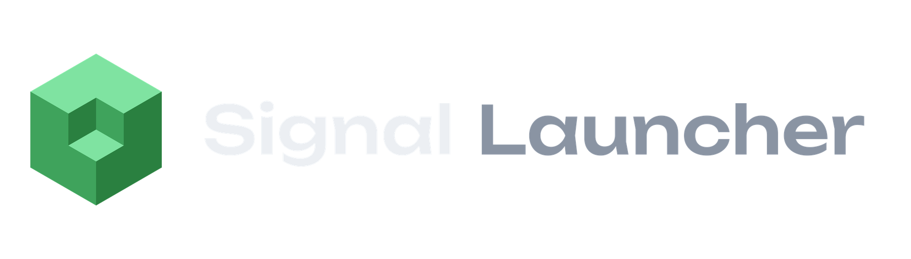

<div align="center">



# Signal Launcher

**Fast, lightweight, and modern Minecraft launcher with automated dependency resolution.**

[](https://github.com/signallauncher/signal-launcher/releases)
[](LICENSE)
[](#getting-started)
[](https://tauri.app)
[](https://www.rust-lang.org)
[](https://react.dev)

</div>

<p align="center">
  <!-- Screenshot placeholder: add a launcher screenshot at .github/assets/screenshot.png and replace this comment with
   -->
  <em>Interface screenshot coming soon.</em>
</p>

---

## Table of Contents

- [Features](#features)
- [Architecture / Tech Stack](#architecture--tech-stack)
- [Getting Started / Development](#getting-started--development)
- [Configuration](#configuration)
- [Disclaimer & Compliance](#disclaimer--compliance)
- [License](#license)

## Features

- **High-speed modpack generation and discovery.** Browse Modrinth and CurseForge mods, modpacks, resource packs and
  shaders in one catalog, import `.mrpack` and CurseForge `manifest.json` packs, or describe an idea and let the AI
  pack builder assemble a modpack for you. Downloads run in parallel and every file is verified by its SHA-1 hash.
- **Automatic dependency resolution for Fabric, Forge, and NeoForge.** Required dependencies (for example Fabric API)
  are resolved for the installation's game version and loader and installed together with the mod. The loader itself
  and the matching Java runtime are installed automatically on first launch.
- **Strict adherence to mod author distribution permissions.** CurseForge files whose authors disabled third-party
  distribution (`allowModDistribution: false`, or no `downloadUrl`) are never downloaded by the launcher: instead it
  links to the project page on CurseForge. Files are fetched only from the official CurseForge CDN.
- **Smart caching to minimize API and CDN load.** Game files, libraries and assets that are already present are never
  downloaded again; the version manifest and news feed are cached locally and work offline; catalog searches are
  debounced; AI pack requests go through the Signal backend, which keeps the provider key server-side and applies
  per-IP and global rate limits.
- **Modern, distraction-free user interface.** A frameless window with a 3D skin and cosmetics viewer, per-instance
  folders, world backups, a developer console with crash detection, Microsoft sign-in, Discord Rich Presence,
  signed auto-updates, and English and Russian localization.

## Architecture / Tech Stack

```
┌─────────────────────────────┐        HTTPS / WebSocket        ┌─────────────────────────────┐
│  Signal Launcher (desktop)  │  ─────────────────────────────▶  │  signal-api (backend)       │
│  Tauri v2 · Rust · React    │                                  │  Rust · axum · SQLite       │
└──────────────┬──────────────┘                                  └─────────────────────────────┘
               │ official APIs
               ▼
   Mojang · Modrinth · CurseForge · Fabric / Forge / NeoForge mavens
```

**Client (this repository)**

| Layer | Technology |
|---|---|
| Desktop shell | [Tauri v2](https://tauri.app) (WebView2) with `tauri-plugin-updater` and `tauri-plugin-dialog` |
| Backend core | Rust 2021: `tokio`, `reqwest` (rustls), `serde`, `zip`, `fastnbt`, `sha1`/`sha2`, `sysinfo` |
| Frontend | [Vite 5](https://vitejs.dev), React 18, [Three.js](https://threejs.org) for the skin and cosmetics viewer |
| Integrations | Microsoft / Xbox Live sign-in (device code flow, tokens encrypted with Windows DPAPI), Discord Rich Presence, UPnP |
| Localization | Built-in i18n layer (`src/i18n/`), English and Russian |

**Backend: signal-api** (separate service, not part of this repository)

| Layer | Technology |
|---|---|
| HTTP / WebSocket server | Rust, [axum 0.8](https://github.com/tokio-rs/axum), `tokio` |
| Storage | SQLite (`rusqlite`, bundled) |
| Responsibilities | Cosmetics catalog, friends and live presence (WebSocket), LAN world relay, AI modpack proxy with rate limiting |
| Deployment | systemd service behind nginx on Ubuntu |

**Repository layout**

```
signal-launcher/
├─ src/                  frontend (UI template, logic, i18n, 3D viewer)
├─ public/assets/        images, sounds, cosmetic assets
├─ src-tauri/
│  ├─ src/               Rust backend: game, loaders, mods, curseforge, modrinth, auth, updater, …
│  ├─ tauri.conf.json    window, bundle and updater configuration
│  └─ build.rs           embeds build-time keys from the environment
├─ scripts/              maintenance scripts (i18n extraction)
└─ .github/workflows/    signed release builds
```

## Getting Started / Development

### Prerequisites

- **Windows 10/11** with [WebView2](https://developer.microsoft.com/microsoft-edge/webview2/) (preinstalled on Windows 11)
- [Node.js](https://nodejs.org) 20+
- [Rust](https://rustup.rs) (stable) and Visual Studio Build Tools 2022 with the *Desktop development with C++* workload

See the [Tauri prerequisites guide](https://tauri.app/start/prerequisites/) for details.

### Build and run

```bash
# 1. Clone the repository
git clone https://github.com/signallauncher/signal-launcher.git
cd signal-launcher

# 2. Install frontend dependencies
npm install

# 3. Run in development mode (hot reload for the frontend)
npm run tauri dev
```

The first run compiles the Rust dependencies and takes a few minutes; later starts take seconds.

### Production build

```bash
npm run tauri build
```

Installers are written to `src-tauri/target/release/bundle/` (`nsis/*.exe` and `msi/*.msi`). Release builds sign the
update artifacts, so `TAURI_SIGNING_PRIVATE_KEY` must be set (see [Configuration](#configuration)).

### Tests

```bash
cd src-tauri
cargo test                       # unit tests
cargo test -- --ignored          # live tests against Mojang, Modrinth and CurseForge
```

## Configuration

All keys are optional and read from the environment at build time; see [`.env.example`](.env.example). Without a key
the matching feature is simply hidden. Secrets are never committed: they live in local files ignored by git or in
GitHub Actions secrets.

| Variable | Purpose |
|---|---|
| `SIGNAL_CF_API_KEY` | CurseForge API key issued to Signal Launcher (or `src-tauri/curseforge-api.key`) |
| `SIGNAL_MS_CLIENT_ID` | Azure application id approved by Mojang for Microsoft sign-in |
| `SIGNAL_DISCORD_APP_ID` | Discord application id for Rich Presence |
| `SIGNAL_SERVER` | Alternative signal-api base URL |
| `TAURI_SIGNING_PRIVATE_KEY` | Updater signing key for release builds |

## Disclaimer & Compliance

Signal Launcher is an independent project. It is **not an official Minecraft product** and is not approved by,
endorsed by, or affiliated with Mojang Studios or Microsoft. *Minecraft* is a trademark of Mojang Synergies AB.
Playing online requires a legitimately purchased Minecraft: Java Edition account.

Signal Launcher uses the CurseForge 3rd Party API under its own API key and respects the
[CurseForge 3rd Party API Terms and Conditions](https://support.curseforge.com/en/support/solutions/articles/9000207405-curse-forge-3rd-party-api-terms-and-conditions):

- files are downloaded only when the author allows third-party distribution (`allowModDistribution`);
  otherwise the user is sent to the project page on CurseForge;
- downloads come only from the official CurseForge CDN and are verified by hash;
- the API key belongs to this project and is never shared with or borrowed from other applications;
- mod names, authors, descriptions and download counts are shown as provided by CurseForge, with links back
  to the original project pages.

Modrinth content is accessed through the public [Modrinth API](https://docs.modrinth.com) under its usage terms.
All mods, modpacks and assets remain the property of their respective authors.

## License

Signal Launcher is released under the [MIT License](LICENSE).
